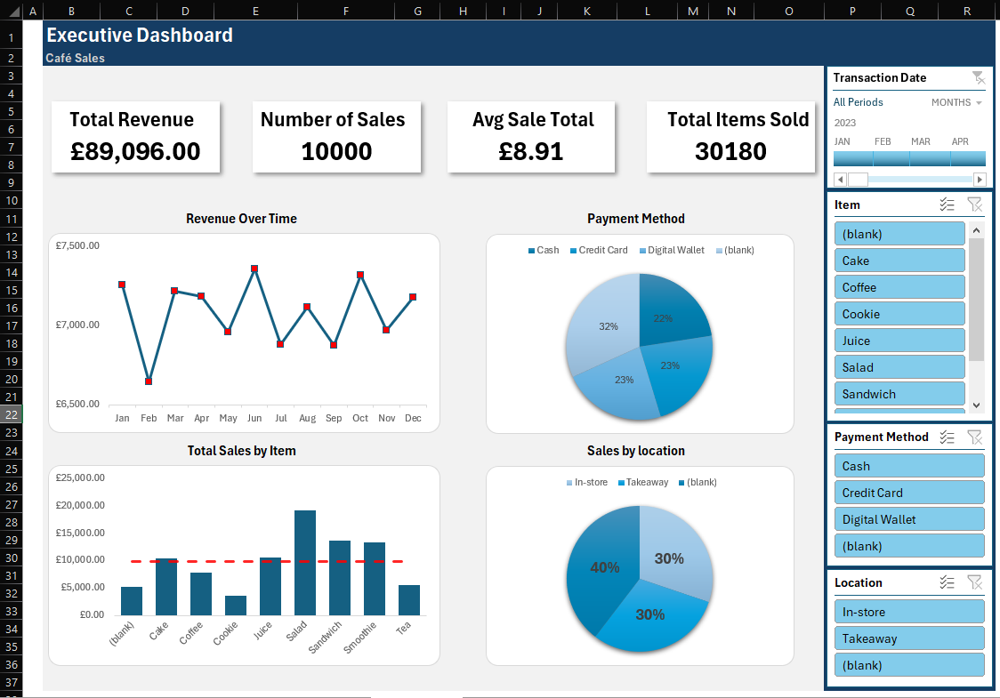

# Café Sales Cleaning & Dashboard — Excel

## Objective

Clean a messy café transaction dataset and turn it into an analysis-ready dataset and interactive sales dashboard.

The project combines data-quality work with business reporting, covering revenue, sales volume, product performance, payment methods, locations and sales over time.

## Dataset

Transaction-level café sales data containing fields such as:

`Transaction ID`, `Item`, `Quantity`, `Price Per Unit`, `Total Spent`, `Payment Method`, `Location`, `Transaction Date`

## Tools

- Microsoft Excel
- Data cleaning and transformation
- PivotTables / PivotCharts
- Slicers
- Timeline
- Dashboard design

## Data Cleaning Process

The cleaning process was designed to recover values only when they could be calculated or supported by the available data.

1. Matched known items to their observed price per unit.
2. Filled missing **Price Per Unit** values by using the item-to-price relationship.
3. Calculated missing **Price Per Unit** values using `Total Spent ÷ Quantity` where both fields were available.
4. Used price-per-unit information to investigate missing items.
5. Left item values blank where multiple different items shared the same price, because the correct item could not be determined reliably.
6. Calculated missing **Total Spent** using `Price Per Unit × Quantity`.
7. Calculated missing **Quantity** using `Total Spent ÷ Price Per Unit`.
8. Changed **Transaction Date** to a Date data type.
9. Changed invalid values in **Payment Method**, **Location** and **Transaction Date** to null.
10. Changed **Price Per Unit** and **Total Spent** to currency formatting.

This approach avoids inventing information that cannot be supported by the source data.

## Dashboard Analysis

- Total revenue
- Number of sales
- Average sale total
- Total items sold
- Revenue over time
- Sales by item
- Payment method mix
- Location mix
- Interactive Item, Payment Method and Location slicers
- Transaction Date timeline

## Key Findings

The dashboard headline KPIs show:

- Total revenue: **£89,096.00**
- Number of sales: **10,000**
- Average sale total: **£8.91**
- Total items sold: **30,180**

Sales by item show **Salad (£19,095)** as the largest contributor, followed by **Sandwich (£13,716)** and **Smoothie (£13,344)**.

The dashboard also makes the remaining missing-data issue visible: some payment-method and location records remain blank after invalid values were converted to null, and some item identities remain blank where the available pricing information was not sufficient to determine the correct product.

## Dashboard

